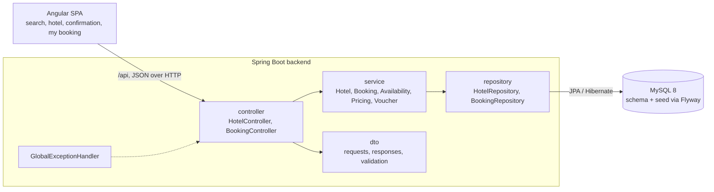
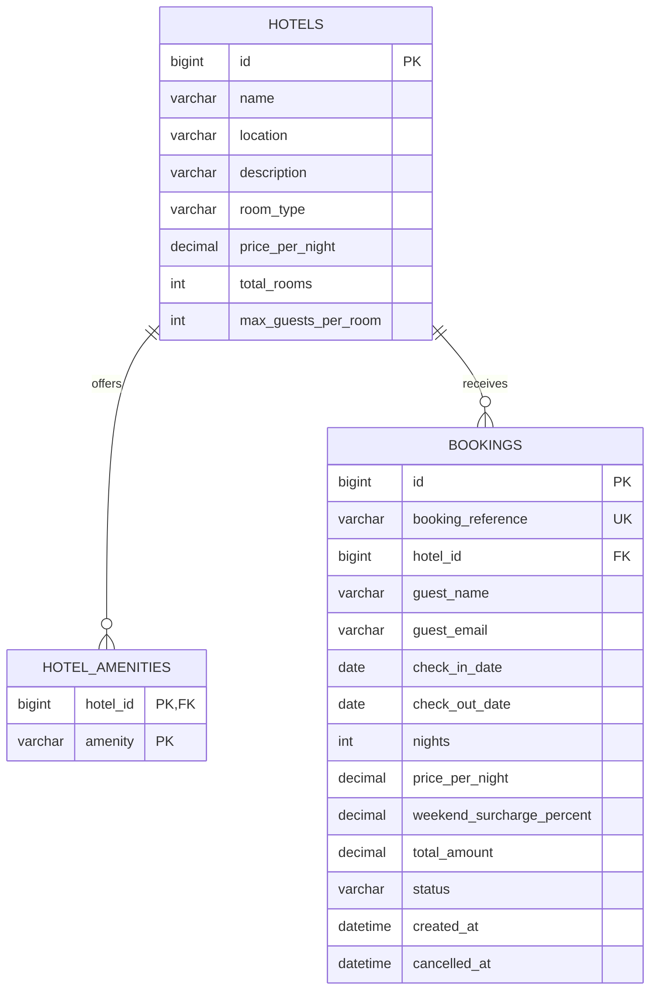
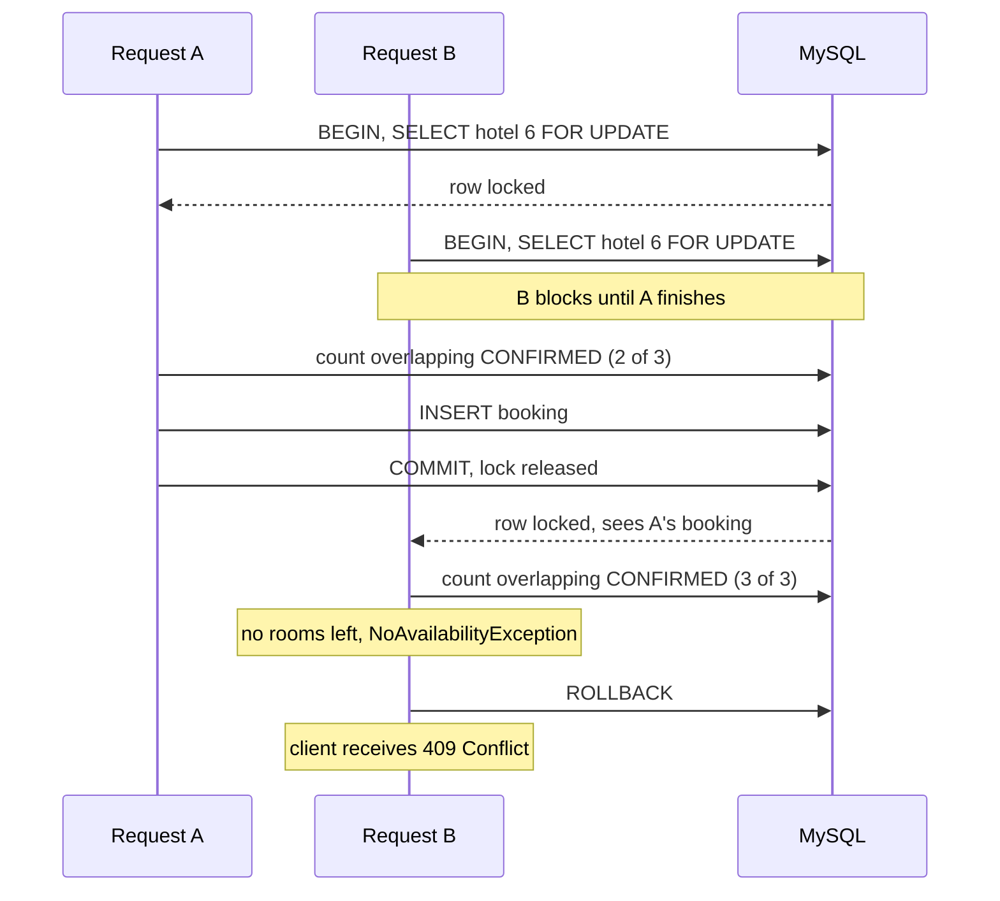

# Design Document

Architecture and design decisions for the Padav hotel booking portal.
For setup and run instructions see [README.md](README.md).

## Contents

1. [System architecture](#1-system-architecture)
2. [Database schema and constraints](#2-database-schema-and-constraints)
3. [REST API contracts](#3-rest-api-contracts)
4. [Booking and overlap logic](#4-booking-and-overlap-logic)
5. [Concurrency control](#5-concurrency-control)
6. [Surprise feature: weekend pricing and booking voucher](#6-surprise-feature-weekend-pricing-and-booking-voucher)
7. [Validation, errors and security](#7-validation-errors-and-security)
8. [Frontend architecture](#8-frontend-architecture)
9. [Testing strategy](#9-testing-strategy)
10. [Design trade-offs](#10-design-trade-offs)
11. [Future improvements](#11-future-improvements)

---

## 1. System architecture



**Backend layers** (package `com.thomascook.hotelbooking`):

| Package | Responsibility |
|---|---|
| `controller` | HTTP only: bind and validate input (`@Valid`), call one service method, return a DTO. No business logic. |
| `service` | All business rules and transactions: `BookingService`, `AvailabilityService`, `PricingService`, `HotelService`, `VoucherService`, `BookingReferenceGenerator`. |
| `repository` | Spring Data JPA interfaces, including the overlap count query and the `FOR UPDATE` hotel lookup. |
| `entity` | `Hotel`, `Booking`, `BookingStatus`. Never serialized to clients. |
| `dto` | Request and response records plus the `@ValidStayDates` constraint. The API contract is independent of the table layout. |
| `exception` | `ApiException` subclasses (404, 409) and the `@RestControllerAdvice` that turns every failure into one JSON shape. |
| `config` | `PricingProperties` (bound from `app.pricing.*`), `CorsConfig`, `AppTime` (IST "today"). |

**Principles followed**

- The **server is the source of truth** for prices, availability, validation and booking state. The UI only displays what the API returns.
- **Schema is owned by Flyway**; Hibernate runs with `ddl-auto: validate` so a mismatch between entities and tables fails at startup instead of at runtime.
- `spring.jpa.open-in-view=false`: all lazy loading happens inside service transactions, never in the web layer.
- **Stateless API**: no sessions or cookies, so the backend can run as several instances behind a load balancer (the concurrency design relies on the database, not on JVM memory).

---

## 2. Database schema and constraints



Migrations: `V1__create_schema.sql` (tables, constraints, index) and `V2__seed_hotels.sql` (8 hotels with amenities).

### `hotels`

| Column | Type | Notes |
|---|---|---|
| `id` | `BIGINT` auto increment | Primary key |
| `name`, `location` | `VARCHAR(150)` | Unique together (`uk_hotels_name_location`); `location` is indexed for search |
| `description` | `VARCHAR(1000)` | |
| `room_type` | `VARCHAR(100)` | One room category per hotel |
| `price_per_night` | `DECIMAL(10,2)` | `CHECK > 0` |
| `total_rooms` | `INT` | Inventory. `CHECK > 0`. This row is also the lock target (section 5) |
| `max_guests_per_room` | `INT` | Informational. `CHECK > 0` |

`hotel_amenities` holds one row per amenity (`PRIMARY KEY (hotel_id, amenity)`, `ON DELETE CASCADE`). Mapped as an `@ElementCollection` with `@BatchSize`, so listing hotels costs a constant number of queries rather than one per hotel.

### `bookings`

| Column | Type | Notes |
|---|---|---|
| `booking_reference` | `VARCHAR(20)` | `UNIQUE`. Format `TC-<year>-<6 chars>` |
| `hotel_id` | `BIGINT` | `FOREIGN KEY` to `hotels(id)` |
| `guest_name` / `guest_email` | `VARCHAR(100)` / `VARCHAR(254)` | Email stored lower-cased; matched case-insensitively |
| `check_in_date`, `check_out_date` | `DATE` | Stay is the half-open interval `[check_in, check_out)` |
| `nights` | `INT` | `CHECK > 0` |
| `price_per_night`, `weekend_surcharge_percent`, `total_amount` | `DECIMAL` | **Price snapshot** taken at booking time (see section 6) |
| `status` | `VARCHAR(20)` | `CHECK IN ('CONFIRMED','CANCELLED')`. Mapped as VARCHAR on purpose; Hibernate 6.2+ would otherwise expect a native MySQL `ENUM` and fail validation |
| `created_at`, `cancelled_at` | `DATETIME(6)` | Written by the service in IST; `cancelled_at` is null until cancelled |

Other constraints: `CHECK (check_out_date > check_in_date)` and `CHECK (total_amount >= 0)`, so even a buggy caller cannot store an invalid stay.

**Index** `idx_bookings_availability (hotel_id, status, check_in_date, check_out_date)` serves the overlap query: equality on hotel and status first, then range conditions on the dates.

---

## 3. REST API contracts

Base path `/api`. JSON in and out. Dates are `yyyy-MM-dd`. Amounts are numbers in INR.

### Error format (all endpoints)

```json
{
  "timestamp": "2026-11-24T05:10:41.532Z",
  "status": 400,
  "error": "Bad Request",
  "message": "Check-in date must be today or a future date",
  "fieldErrors": [
    { "field": "checkInDate", "message": "Check-in date must be today or a future date" }
  ]
}
```

`fieldErrors` is an empty array for non-validation errors. With a single field error, `message` repeats it; with several, `message` is
`"Validation failed. Please correct the highlighted fields."`.

| Status | When |
|---|---|
| `400` | Validation failure, malformed JSON, invalid date format, bad path or query value |
| `404` | Unknown hotel; booking lookup where reference and email do not match (deliberately indistinguishable) |
| `405`, `415` | Wrong method or media type (handled via Spring's `ErrorResponse`) |
| `409` | No rooms left for the dates; cancelling a booking that is already cancelled |
| `503` | Could not get the booking lock in time (heavy contention). Safe to retry |
| `500` | Anything unexpected. Generic message, details only in the server log |

### `GET /api/hotels`

Query: `location` (optional, case-insensitive "contains"), `checkInDate` and `checkOutDate` (optional, but both or neither).
Without dates `availableRooms` is `null`; with dates it is the rooms left (never negative). Sold-out hotels are still returned, with `0`.

```json
[
  {
    "id": 6,
    "name": "Lake Pichola Residency",
    "location": "Udaipur, Rajasthan",
    "description": "A boutique lakefront hotel with only three royal rooms...",
    "roomType": "Lake-View Royal Room",
    "maxGuestsPerRoom": 2,
    "amenities": ["Air conditioning", "Boat rides", "Breakfast included", "Free Wi-Fi", "Lake view", "Rooftop restaurant"],
    "pricePerNight": 12500.00,
    "totalRooms": 3,
    "availableRooms": 2
  }
]
```

### `GET /api/hotels/{id}`

Same object as above for one hotel, `availableRooms: null`. `404` if unknown.

### `GET /api/hotels/{id}/availability?checkInDate=&checkOutDate=`

Same object with `availableRooms` filled in for the stay. Both dates required and validated (see section 7).

### `GET /api/hotels/{id}/quote?checkInDate=&checkOutDate=`

The exact price the booking would get. Example: hotel 6, Friday 4 Dec to Monday 7 Dec 2026.

```json
{
  "checkInDate": "2026-12-04",
  "checkOutDate": "2026-12-07",
  "nights": 3,
  "pricePerNight": 12500.00,
  "weekendNights": 2,
  "weekendSurchargePercent": 15.00,
  "baseAmount": 37500.00,
  "surchargeAmount": 3750.00,
  "totalAmount": 41250.00,
  "currency": "INR",
  "nightlyBreakdown": [
    { "date": "2026-12-04", "dayOfWeek": "FRIDAY",   "weekendNight": true,  "basePrice": 12500.00, "surcharge": 1875.00, "price": 14375.00 },
    { "date": "2026-12-05", "dayOfWeek": "SATURDAY", "weekendNight": true,  "basePrice": 12500.00, "surcharge": 1875.00, "price": 14375.00 },
    { "date": "2026-12-06", "dayOfWeek": "SUNDAY",   "weekendNight": false, "basePrice": 12500.00, "surcharge": 0.00,    "price": 12500.00 }
  ]
}
```

### `POST /api/bookings` returns `201`

```json
{
  "hotelId": 6,
  "checkInDate": "2026-12-04",
  "checkOutDate": "2026-12-07",
  "guestName": "Vi Kapoor",
  "guestEmail": "vi@example.com"
}
```

There is intentionally **no price field**. Unknown properties (for example a client-sent `totalAmount`) are ignored, and a test proves it.
The response is a booking:

```json
{
  "bookingReference": "TC-2026-ZJ5U2V",
  "status": "CONFIRMED",
  "cancellable": true,
  "hotelId": 6,
  "hotelName": "Lake Pichola Residency",
  "hotelLocation": "Udaipur, Rajasthan",
  "roomType": "Lake-View Royal Room",
  "guestName": "Vi Kapoor",
  "guestEmail": "vi@example.com",
  "checkInDate": "2026-12-04",
  "checkOutDate": "2026-12-07",
  "nights": 3,
  "createdAt": "2026-11-24T10:19:41.482915",
  "cancelledAt": null,
  "price": { "...": "same object as the quote above" }
}
```

Errors: `400` validation, `404` unknown hotel, `409` no availability, `503` lock timeout.

### `POST /api/bookings/lookup` and `POST /api/bookings/cancel`

Body for both (the email is in the body, not the URL, so it stays out of access logs and browser history):

```json
{ "bookingReference": "TC-2026-ZJ5U2V", "guestEmail": "vi@example.com" }
```

Returns the booking (`cancel` returns it with `status: "CANCELLED"`, `cancellable: false` and `cancelledAt` set).
The reference is trimmed and upper-cased and the email is trimmed and compared case-insensitively.
`404` if the pair does not match; `409` when cancelling an already cancelled booking.

### `POST /api/bookings/voucher`

Same body. Returns `200` with `Content-Type: text/html;charset=UTF-8` and
`Content-Disposition: attachment; filename="voucher-TC-2026-ZJ5U2V.html"`. Same `404` rule as lookup.

---

## 4. Booking and overlap logic

### The overlap rule

A stay is the half-open interval `[checkIn, checkOut)`: the guest occupies the room on the nights from check-in up to, but not including, the check-out day. Two stays `[startA, endA)` and `[startB, endB)` overlap **if and only if**

```
startA < endB   AND   endA > startB
```

which is exactly the `WHERE` clause of `BookingRepository.countOverlappingConfirmed`:

```
status = 'CONFIRMED' AND check_in_date < :requestedCheckOut AND check_out_date > :requestedCheckIn
```

Using strict inequalities means a guest arriving on the day another guest leaves does **not** conflict (checkout in the morning, check-in in the afternoon).

### Worked example

An existing CONFIRMED stay is `[Dec 10, Dec 14)`:

| Requested stay | Overlaps? | Why |
|---|---|---|
| `[Dec 14, Dec 16)` | No | Starts on the existing check-out day |
| `[Dec 8, Dec 10)` | No | Ends on the existing check-in day |
| `[Dec 8, Dec 11)` | Yes | Shares the night of Dec 10 |
| `[Dec 13, Dec 15)` | Yes | Shares the night of Dec 13 |
| `[Dec 11, Dec 13)` | Yes | Inside the existing stay |
| `[Dec 9, Dec 15)` | Yes | Contains the existing stay |
| `[Dec 10, Dec 14)` | Yes | Identical |

These seven cases are the parameterized test `AvailabilityIntegrationTest.overlapRuleIsHalfOpen`.

### Availability

```
availableRooms = max(0, hotel.totalRooms - count(CONFIRMED bookings overlapping the requested dates))
```

`CANCELLED` bookings are never counted, so **cancelling releases the room immediately**: there is no separate inventory to update.
The search page fetches the overlap counts for all hotels with one grouped query, avoiding an N+1.

### Creating a booking (`BookingService.createBooking`, one transaction)

1. Load the hotel with `SELECT ... FOR UPDATE` (section 5). `404` if unknown.
2. Count overlapping CONFIRMED bookings; if `totalRooms - count <= 0`, throw `NoAvailabilityException` (`409`).
3. Compute the price on the server (`PricingService.quote`).
4. Generate a unique reference (`TC-<year>-<6 random chars>`) and save the booking with the price snapshot.
5. Commit, which releases the lock.

Reference characters come from a 31-character alphabet without look-alikes (no `0/O`, `1/I/L`), using `SecureRandom`
(about 887 million combinations per year). Uniqueness is checked before saving and also enforced by the unique index.

### Known limitation of the specified formula

Counting overlapping *bookings* is simple and can **never overbook**, but it is conservative. Example: 2 rooms, bookings `[Dec 1, Dec 3)` and
`[Dec 3, Dec 5)` could share one physical room. A request for `[Dec 1, Dec 5)` overlaps both, so the count is 2 and the hotel reports 0 rooms
left, although one room is actually free for all four nights. Fixing this needs per-night occupancy (section 11). It is a deliberate
trade-off for a single-category assignment where the formula was specified.

---

## 5. Concurrency control

**Problem.** Two guests book the last room at the same moment. Both read "1 room left", both insert, the hotel is overbooked.

**Solution.** A pessimistic write lock on the `Hotel` row, taken at the start of the booking transaction:

```java
@Lock(LockModeType.PESSIMISTIC_WRITE)
@Query("select h from Hotel h where h.id = :id")
Optional<Hotel> findByIdForUpdate(@Param("id") Long id);   // SELECT ... FOR UPDATE
```

called first inside `@Transactional BookingService.createBooking`.



**Why this is correct**

- The lock serializes the *check-then-insert* sequence per hotel, so the second request always counts the first one's committed booking.
- **Order matters on MySQL.** InnoDB's default isolation is `REPEATABLE READ`: a plain `SELECT COUNT(*)` reads from a snapshot created at the transaction's *first non-locking read*, while `SELECT ... FOR UPDATE` always reads the latest committed data. Because the lock is the very first statement and the count comes after it, the snapshot is created *after* the previous transaction committed. Reordering these two steps would reintroduce the race. The service comment documents this.
- **Scope of the lock is one hotel.** Bookings for different hotels never block each other, and reads (search, availability, quote) take no locks.
- **No deadlocks by construction.** Every booking transaction takes exactly one lock (one hotel row) and never another, so there is no lock cycle. Cancellation takes no hotel lock.
- **Bounded waiting.** A waiter blocks for at most MySQL's `innodb_lock_wait_timeout` (default 50 s). On expiry Spring raises `PessimisticLockingFailureException`, which the handler maps to `503` with a "try again" message.
- **Works across several backend instances**, because the lock lives in the database.

**Cancellation.** It does not lock the hotel (it only frees capacity). Two simultaneous cancels of the same booking both end in `CANCELLED`; the outcome is the same, so no extra guard was added (see future improvements for `@Version`).

**Alternatives considered**

| Option | Why not |
|---|---|
| Optimistic locking (`@Version` on `Hotel`) with retry | Every booking would update the hotel row just to bump the version; under contention most attempts fail and need retry loops. The assignment explicitly asks for pessimistic locking, and contention per hotel is low enough that waiting is cheap. |
| `SERIALIZABLE` isolation | Locks far more than needed (range locks on bookings), increasing deadlocks and aborts. |
| Per-night counter table with `UPDATE ... WHERE remaining > 0` | The better long-term design (section 11), but a bigger schema change than the assignment needs. |
| Distributed lock (Redis) | Adds infrastructure and a second source of truth for something the database already does. |

**Evidence.** `BookingConcurrencyIntegrationTest` releases 8 threads at the same instant against a 3-room hotel and asserts exactly 3 bookings and 5
`NoAvailabilityException`s with distinct references; a second test leaves one room and races two guests for it. Any other exception (deadlock, lock timeout,
constraint violation) fails the test. Those tests run on H2, which also supports row-level `FOR UPDATE`, so they prove the application logic; a run against
real MySQL (Testcontainers) is listed under future improvements.

---

## 6. Surprise feature: weekend pricing and booking voucher

### Dynamic weekend pricing

Implemented only in `PricingService`; the quote endpoint, the booking and the voucher all use it.

- A **night** is the night that *starts* on a given date. A stay `[Thu, Mon)` has four nights: Thu, Fri, Sat, Sun. The check-out day is never charged.
- **Friday and Saturday nights** get a surcharge of `app.pricing.weekend-surcharge-percent` (15) on that night's base price.
- Rounding: the surcharge per night is `price x percent / 100` rounded `HALF_UP` to 2 decimals. The total is the sum of the nightly prices, so the lines shown always add up to the total exactly.
- The response contains every night (`date`, `dayOfWeek`, `weekendNight`, `basePrice`, `surcharge`, `price`), plus `baseAmount`, `surchargeAmount`, `totalAmount` and `weekendNights`.

**Price snapshot.** `price_per_night` and `weekend_surcharge_percent` are copied onto the booking. The breakdown shown later (lookup, voucher) is
re-derived from that snapshot, so changing a hotel's rate or the surcharge in the future never rewrites an existing booking.

**Frontend.** The booking panel shows the nights as rows with weekend nights highlighted and tagged "Weekend +15%", followed by
`n nights at rate`, `Weekend surcharge`, and the total (which animates when the dates change). The same component is reused inside the booking ticket.
The UI never calculates a price.

*Seasonal pricing:* the extension point is `PricingService.calculate`, which today applies one rule (weekend). Adding seasons or festival dates would mean
a rules table and a per-night multiplier lookup (section 11).

### Downloadable voucher

- `POST /api/bookings/voucher` renders one **self-contained HTML document** (inline CSS, no external assets) on the server in `VoucherService`:
  reference, status badge, hotel, guest, dates, the night-by-night table, the surcharge line and the total. A cancelled booking gets a red "no longer valid" banner.
- Every dynamic value goes through `HtmlUtils.htmlEscape`, so guest-supplied text cannot inject markup.
- Print styles hide the button and background; the **Print / Save as PDF** button uses the browser's print dialog. This delivers a real PDF without adding a PDF library to the backend.
- Because the voucher is built from the same booking data as the screen, the numbers cannot drift from what the guest saw.
- Access requires the same reference + email proof as lookup. The Angular app calls it with `responseType: 'blob'`, reads the filename from `Content-Disposition` (exposed through CORS), and saves the file; error responses arrive as a Blob and are unwrapped back into the standard error shape.

---

## 7. Validation, errors and security

### Validation

| Where | Rule |
|---|---|
| `@ValidStayDates` (class level, on `CreateBookingRequest`, `StayRequest`, `HotelSearchRequest`) | `checkInDate` is today or later (evaluated in IST via `AppTime`); `checkOutDate` is strictly after `checkInDate`; stay is at most 30 nights. On search, dates are optional but must come as a pair. Violations are attached to the offending property (`checkInDate` or `checkOutDate`), so the UI can show them under the right input. |
| Field annotations | `@NotNull`, `@NotBlank`, `@Size`, and an email pattern requiring a dot in the domain |
| Database | `CHECK` constraints for dates, nights, status, prices, room counts |

`StayDatesValidator` leaves missing values to `@NotNull` so each problem is reported once. The request records also expose JavaBean-style getters because Spring's
validation adapter reads rejected values of cross-field violations by property name.

### Error handling

`GlobalExceptionHandler` (`@RestControllerAdvice`) produces the single error shape from section 3 for: business exceptions, bean validation (bodies and query objects), constraint violations,
malformed JSON and bad date formats (reported per field, for example `checkInDate: Dates must use the format yyyy-MM-dd`), type mismatches, lock timeouts, data integrity violations, Spring's own web exceptions, and a catch-all
that logs the stack trace and returns a generic message.

### Security and configuration

- **No secrets in the repo**: `application.yml` reads `DB_URL`, `DB_USERNAME`, `DB_PASSWORD` from the environment or an ignored `.env`; there is no default password, so the app refuses to start unconfigured. `.env.example` documents the variables; `.gitignore` excludes `.env`.
- **SQL injection**: all queries are JPA/JPQL with bound parameters.
- **XSS**: Angular escapes by default; the server-rendered voucher escapes explicitly.
- **Privacy**: the guest email travels in POST bodies, not URLs; a wrong email and an unknown reference return the same `404`; error responses never include stack traces.
- **CORS** is limited to the configured origin(s) on `/api/**`; in development the Angular proxy makes requests same-origin.
- **Not covered** (out of scope or listed in section 11): rate limiting on lookup, authentication, CSRF (there are no cookies or sessions to protect), audit logging.

---

## 8. Frontend architecture

Angular 22 application: standalone components, **signals** for state, reactive forms, the new control-flow syntax, no component library.

```
frontend/src/app/
├── core/          models.ts, app-error.ts, hotel-api.ts, booking-api.ts, toast.ts, download.ts
├── shared/        hotel-scene, price-breakdown, booking-ticket, petals, toast-host, inr pipe, dates helpers
└── pages/
    ├── search/          /                      filters + hotel cards
    ├── hotel-detail/    /hotels/:id            dates, availability, price, guest form, booking
    ├── confirmation/    /confirmation/:ref     ticket, voucher download
    └── manage/          /manage                lookup, cancel, voucher
```

- **Routing**: pages are lazy loaded; route and query params arrive as component inputs (`withComponentInputBinding`), so `/hotels/6?checkInDate=...` needs no manual parsing.
- **URL as state on the search page**: submitting the form navigates with query params, and a single RxJS stream (`queryParamMap` then `switchMap` to the API) loads results. Back/forward and shared links just work, and the dates carry over to the hotel page.
- **Hotel page**: the date controls feed a debounced `switchMap` that calls availability and quote together (`forkJoin`), cancelling stale requests. The submit button is disabled while loading, sold out or submitting.
- **Error handling**: services convert every failure into an `AppError` (status, message, field errors). `400` field errors are attached to the matching form controls; a `409` shows a "those dates just filled up" banner and refreshes availability; network failures say the backend is unreachable.
- **Confirmation page**: arrives with the booking in router state for an instant render, then re-fetches from the server (reference and email are kept in `sessionStorage` for this tab only), so a refresh or a stale state never shows wrong data.
- **Zoneless change detection**: components rely on signals; the few programmatic form-error updates call `markForCheck`.
- **Visual design**: no image assets. Each hotel has a hand-built SVG landscape chosen by destination (`HotelScene`); the booking is drawn as a ticket with a tear-off stub and a stamp. Motion is limited to a one-time sunrise, staggered card reveal, the stamp, a petal burst after booking, and a total that counts up; all of it is disabled under `prefers-reduced-motion`.
- **Accessibility**: labelled inputs, `aria-live` regions for availability, totals and errors, visible focus rings, a skip link, semantic lists and `<details>` for the breakdown.
- **Build and dev**: `npm start` serves on 4200 and proxies `/api` to the backend (`proxy.conf.json`); `npm run build` type-checks all templates strictly. Font inlining is turned off in the production build so it also builds offline.

---

## 9. Testing strategy

| Level | Tests | What they prove |
|---|---|---|
| Unit (pure) | `PricingServiceTest` (10), `StayDatesValidationTest` (12) | Money and date rules, with fixed dates so weekdays are deterministic |
| Unit (Mockito) | `BookingServiceTest` (8) | Service orchestration: what is saved, when the booking is rejected, state transitions, normalization |
| Integration (DB) | `AvailabilityIntegrationTest` (5 methods, 11 cases) | The overlap SQL against a real schema, back-to-back stays, cancelled bookings, inventory release |
| Integration (concurrency) | `BookingConcurrencyIntegrationTest` (2) | No overbooking under truly simultaneous requests |
| Integration (HTTP) | `BookingApiIntegrationTest` (17) | The public contract: statuses, error JSON, validation messages, lifecycle, voucher |

All integration tests boot the full Spring context on in-memory H2 in MySQL mode, running the **production Flyway migrations and seed data**. Tests are not `@Transactional`
(so the concurrency test sees real commits); bookings are deleted after each test. Dates are computed relative to "today" so the suite does not age.

**Honest limits:** H2 is not MySQL (isolation defaults and lock waiting differ slightly; section 5 explains why the design holds on InnoDB); the frontend has no unit or end-to-end tests.

---

## 10. Design trade-offs

| Decision | Chosen | Given up |
|---|---|---|
| Availability as a count of overlapping bookings | Simple, matches the spec, never overbooks | Slightly conservative for long stays (section 4) |
| Pessimistic lock per hotel | Correct and easy to reason about; no retry logic | Bookings for the same hotel queue; a hot hotel is a bottleneck (acceptable: each critical section is two short queries) |
| Server-rendered HTML voucher + browser print | No PDF dependency, always consistent with the data | Not a true generated PDF file |
| Price snapshot on the booking | History never changes when rates change | A few redundant columns |
| Email + reference as the "credential" | No accounts needed, as required | Weaker than real authentication; no rate limit |
| Lookup and cancel via `POST` | Email stays out of URLs and logs | Not idempotent-looking REST; not cacheable (desired) |
| Flyway + `ddl-auto: validate` | Reproducible schema, mismatches caught at startup | Schema changes need a new migration file |
| DTO records, entities never exposed | API stable against schema changes | Some mapping code |
| Hand-drawn SVG scenes instead of photos | No external image dependency, unique look, tiny payload | Illustrations, not real hotel photography |
| H2 for tests | Zero setup for reviewers | Not the production database engine |
| One room per booking, no guest count | Matches the brief's scope | Cannot express multi-room or occupancy rules |

---

## 11. Limitations and future improvements, and in the contents list change the last link to [Limitations and future improvements](#11-limitations-and-future-improvements).

**Correctness and scale**

- **Per-night inventory**: a `room_inventory(hotel_id, date, booked)` table updated with `UPDATE ... SET booked = booked + 1 WHERE booked < total`. This removes the conservative-count limitation, makes availability O(nights), and can replace the row lock.
- **Run the concurrency tests against real MySQL** with Testcontainers in CI.
- **Idempotency keys** on `POST /api/bookings` so a retried or double-clicked request never creates two bookings (the UI only guards with a disabled button).
- **Optimistic `@Version` on bookings** to make double cancellation strictly single-winner.
- Cancellation policy: block or fee for cancelling after check-in or inside a window.

**Product**

- Seasonal and festival pricing from a rules table; length-of-stay discounts.
- Multiple room categories, guest counts, multi-room bookings.
- Email confirmation with the voucher attached; true PDF generation (for example OpenPDF).
- Accounts, booking history, admin tools (all excluded by the brief).
- Pagination, sorting and richer filters (price, amenities); caching for hotel data.

**Engineering**

- Rate limiting and lockout on lookup/cancel; audit log of booking changes.
- OpenAPI/Swagger documentation generated from the controllers.
- CI pipeline (build, test, lint), Docker Compose for MySQL and the app, health and metrics endpoints.
- Frontend unit tests and Playwright end-to-end tests; an accessibility audit.
- Internationalisation and Indian-language support.
